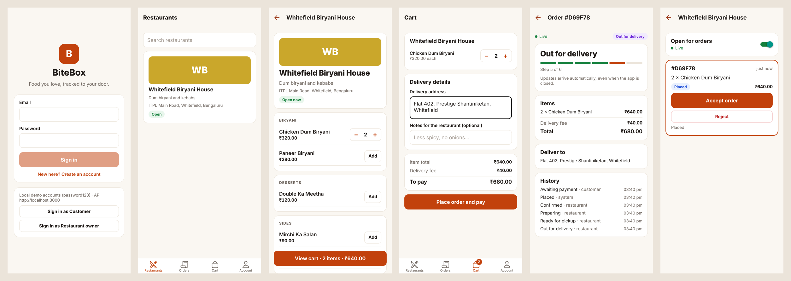
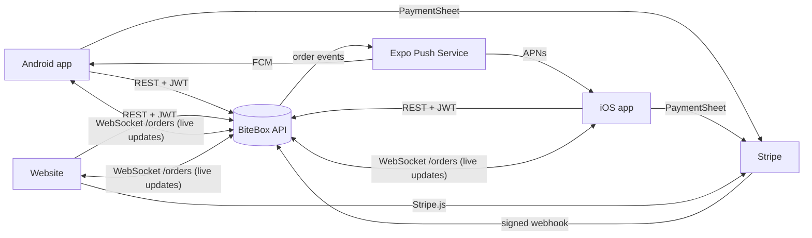

# BiteBox Mobile

The **Android and iOS app** for BiteBox, a food ordering and delivery platform. One codebase, both platforms, built with **Expo** and **React Native**.

It talks to the **same backend** as the website, [bitebox-api](https://github.com/rkparupudi/bitebox-api): the same REST endpoints, the same live order updates, the same accounts and orders. An order placed on a phone shows up on the restaurant's web dashboard, and the other way round.




| | |
|---|---|
| **Framework** | Expo SDK 58 · React Native 0.88 · React 19 · TypeScript (strict) |
| **Navigation** | Expo Router (file-based), bottom tabs + stack |
| **Server state** | TanStack Query 5 |
| **Real time** | Socket.IO client (same `/orders` namespace as the web app) |
| **Push notifications** | `expo-notifications` → Expo Push Service → FCM (Android) / APNs (iOS) |
| **Payments** | Stripe React Native: native **PaymentSheet** (cards; Apple Pay / Google Pay ready) |
| **Secure storage** | `expo-secure-store`: iOS Keychain / Android Keystore |
| **Builds and releases** | EAS Build and EAS Submit (cloud builds; no Mac needed for iOS) |
| **App IDs** | `com.bitebox.app` (Android package and iOS bundle ID) |

---

## Contents

1. [What's in the app](#whats-in-the-app)
2. [How it shares the API with the website](#how-it-shares-the-api-with-the-website)
3. [Run it on your phone (development)](#run-it-on-your-phone-development)
4. [Configuration](#configuration)
5. [Project structure](#project-structure)
6. [How it works](#how-it-works)
7. [Push notifications setup](#push-notifications-setup)
8. [Payments](#payments)
9. [Building for the stores](#building-for-the-stores)
10. [Testing](#testing)
11. [Troubleshooting](#troubleshooting)
12. [Roadmap](#roadmap)

---

## What's in the app

**Customers**
- Browse and search restaurants, menus grouped by category.
- Cart with quantities, a floating "View cart" button, and the "start a new cart?" prompt when switching restaurants.
- Checkout with delivery address and notes.
- Pay with Stripe's native payment sheet (or simulator buttons when testing locally).
- **Live order tracking** with progress bar and history; **push notifications** at every step, even when the app is closed.
- Order history; cancel until the restaurant accepts (refunded automatically).

**Restaurant owners**
- Their restaurants, each with an **Open for orders** switch.
- **Live order board**: new paid orders appear instantly with a highlight, plus a push notification ("New order #A1B2C3 · 2 items").
- Accept → start preparing → ready → out for delivery → delivered, or reject (customer refunded).

Menu editing, sales reports and the admin console stay on the website, where a bigger screen suits them. Admins who sign in on the phone are pointed there.

---

## How it shares the API with the website



- **Same endpoints, same rules.** `src/lib/api.ts` calls exactly the endpoints the website's client does. All permissions, pricing and order rules live in the API, so every client behaves the same.
- **Same types.** `src/lib/types.ts` and `src/lib/format.ts` are the same files as in the web repo, so money formatting, status names and the order workflow can't drift apart.
- **One addition for phones:** the API has `POST /devices` and `DELETE /devices/:token` to register push tokens. The website doesn't use them.

---

## Run it on your phone (development)

### What you need

- **Node.js 22** on your laptop.
- The **BiteBox API running** on your laptop, seeded with demo data (see the API README: `docker compose up -d postgres redis`, `npm run seed`, `npm run start:dev`).
- Your **phone and laptop on the same Wi-Fi**.
- A free **Expo account** (https://expo.dev/signup), for cloud builds.

### Why a "development build" and not Expo Go

Expo Go is a ready-made app for quick experiments, but it can't include extra native code like Stripe's payment sheet, and it can't receive push notifications on Android. Expo's own advice for new SDK 58 projects is to use a development build. That's **your own debug version of BiteBox**, built once in the cloud. After that, code changes load instantly over Wi-Fi, just like Expo Go.

### First time (about 15 minutes, mostly waiting for the cloud build)

```bash
npm install
npx eas-cli@latest login          # your Expo account
npx eas-cli@latest init           # links this project to EAS (fills in the projectId)
```

**Android:**

```bash
npx eas-cli@latest build --profile development --platform android
```

When it finishes, scan the QR code on your Android phone and install the app.

**iPhone** (needs an Apple Developer account, $99/year):

```bash
npx eas-cli@latest device:create                         # register your iPhone (scan the QR code)
npx eas-cli@latest build --profile development --platform ios
```

Install from the link. On iOS 16+, also turn on **Settings → Privacy & Security → Developer Mode**.

**iOS Simulator on a Mac** (free, no Apple account): `npx eas-cli@latest build --profile development-simulator --platform ios`, then drag the downloaded app onto the simulator.

You only rebuild when native settings change (new native library, `app.json` plugin changes). Day-to-day JavaScript changes don't need a rebuild.

### Every day

```bash
npx expo start
```

Open the **BiteBox** development app on your phone. It finds the dev server on your Wi-Fi (or scan the QR code). On the sign-in screen, use **Sign in as Customer** or **Sign in as Restaurant owner** (local demo accounts, password `password123`).

The app works out the API's address automatically: it takes your laptop's Wi-Fi IP from the dev server and uses port 3000 (for example `http://192.168.1.20:3000`). The sign-in screen shows which address it's using.

### Try the real-time flow

Use two devices, or a phone plus the website:
1. On one, sign in as the **restaurant owner** and open the restaurant's **Live orders** board.
2. On the other, sign in as the **customer**, add dishes, check out, then tap **Pay**. With the API's `PAYMENTS_PROVIDER=fake` you'll see simulator buttons.
3. The order appears on the owner's board instantly. Tap through **Accept order → … → Mark delivered** and watch the customer's screen follow along.
4. Lock the customer's phone between steps: push notifications arrive (once push is set up, see below).

### Quick look in a browser

The same code also runs as a web page for quick checks (no push or native payment sheet there):

```bash
npx expo start --web
```

---

## Configuration

| Setting | Where | Purpose |
|---|---|---|
| `EXPO_PUBLIC_API_URL` | `.env` locally; `eas.json` per build profile | The API's address. Leave unset in development to auto-detect. **Set it** for preview and production builds (`https://api.yourdomain.com`) |
| `EXPO_PUBLIC_API_PORT` | `.env` | Port used when auto-detecting (default `3000`) |
| `expo.ios.bundleIdentifier` / `expo.android.package` | `app.json` | `com.bitebox.app`. Must be unique in each store. **Change it before the first store upload** if you want a different ID; it can't be changed afterwards |
| `extra.eas.projectId` | `app.json` | Filled in by `eas init`; needed for push tokens |
| Stripe merchant ID | `app.json` → `@stripe/stripe-react-native` plugin | `merchant.com.bitebox.app`, used for Apple Pay |

`EXPO_PUBLIC_` values are compiled into the app, so they must **never** hold secrets. The Stripe *publishable* key and the payment mode come from the API's `GET /config` at runtime, so one build works against any environment.

---

## Project structure

```
src/
├── app/                          # Expo Router: every file is a screen
│   ├── _layout.tsx               # providers, stack navigator, notification-tap routing
│   ├── index.tsx                 # sends each role to the right place
│   ├── login.tsx, register.tsx
│   ├── customer/                 # customer tabs
│   │   ├── _layout.tsx           # tab bar (Restaurants, Orders, Cart with badge, Account)
│   │   ├── index.tsx             # restaurant list + search
│   │   ├── orders.tsx            # order history (live)
│   │   ├── cart.tsx              # checkout
│   │   └── account.tsx
│   ├── owner/                    # restaurant owner tabs
│   │   ├── _layout.tsx
│   │   ├── index.tsx             # my restaurants
│   │   └── account.tsx
│   ├── restaurant/[id].tsx       # menu
│   ├── order/[id].tsx            # order detail: pay, live progress, history, cancel
│   └── board/[id].tsx            # restaurant's live order board
├── components/
│   ├── ui.tsx                    # Screen, Card, Button, Field, StatusBadge, Qty, OrderProgress…
│   ├── PaymentPanel.tsx          # Stripe PaymentSheet (iOS/Android)
│   ├── PaymentPanel.web.tsx      # browser build: simulator only
│   ├── FakePayment.tsx           # simulator buttons (local testing)
│   └── AccountScreen.tsx
├── lib/
│   ├── api.ts                    # typed client for every endpoint (same as the website's)
│   ├── types.ts, format.ts       # identical to the web repo
│   ├── config.ts                 # works out the API address
│   ├── auth.tsx                  # session restore, sign in/out, push registration
│   ├── storage.ts / .web.ts      # token in Keychain/Keystore (localStorage on web)
│   ├── realtime.ts               # Socket.IO, pauses in background, resyncs on return
│   └── push.ts / .web.ts         # permission, Expo push token, notification taps
└── theme.ts                      # colours shared with the website
assets/images/                    # app icon, adaptive icon layers, splash, notification icon
app.json                          # app name, IDs, permissions, native plugins
eas.json                          # build profiles: development, preview, production
```

Files ending in `.web.ts(x)` replace their native counterpart in the browser build only. Expo picks them automatically.

---

## How it works

### Signing in
`lib/auth.tsx` stores the JWT in **secure storage** (Keychain/Keystore), restores the session on launch with `GET /auth/me`, and signs out automatically if the API answers 401. After sign-in it registers the device for push without blocking the sign-in. Signing out unregisters the push token first, so a shared phone stops receiving the previous user's notifications.

### Live updates and app lifecycle
`lib/realtime.ts` keeps one Socket.IO connection, authenticated with the same token. Phones suspend network connections in the background, so the app **disconnects when backgrounded** and **reconnects and refreshes all data when it comes back**. While it's in the background, push notifications take over.

### Data
TanStack Query caches every API response by key (`['order', id]`, `['restaurant-orders', id]` …). Socket events invalidate the matching keys and the screen refetches. Pull-to-refresh is on every list. Errors in the 4xx range aren't retried.

### Navigation from notifications
Every push carries `{ orderId, restaurantId, status }`. Tapping it opens the order (customers) or the restaurant's live board (owners), whether the app was closed or running.

---

## Push notifications setup

The code is ready; these are one-time account steps.

1. `npx eas-cli@latest init` sets `projectId` in `app.json` (without it, the app skips push and logs a warning).
2. **iOS:** the first `eas build` for iOS offers to create the push key (APNs) for you. Say yes.
3. **Android:** create a Firebase project, add an Android app with package `com.bitebox.app`, create a **service account key** for Firebase Cloud Messaging (FCM v1), then run `npx eas-cli@latest credentials` → Android → *Google Service Account Key for Push Notifications* and upload it. (Expo's guide "Obtain Google Service Account Keys using FCM V1" walks through the Firebase console.)
4. Optional, recommended for production: in your Expo account create an access token with push security turned on, and set it on the API as `EXPO_ACCESS_TOKEN`.

**What gets sent** (by the API, `src/notifications/notifications.module.ts`):

| Event | Customer | Restaurant owner |
|---|---|---|
| Payment received | "Order placed · #A1B2C3" | "New order #A1B2C3 · 2 items for …" |
| Accepted / preparing / ready / out / delivered | one message per step | — |
| Cancelled (after payment) | "Order cancelled… refunded" | "Order #A1B2C3 cancelled" |

Push only works on **real devices** (not simulators or emulators), in a development or store build.

---

## Payments

The app asks the API (`GET /config`) which mode it's in:

| API setting | What the customer sees |
|---|---|
| `PAYMENTS_PROVIDER=fake` (local default) | "Local test mode" with **Pay** and **Simulate a declined card** buttons |
| `PAYMENTS_PROVIDER=stripe` | Stripe's native **PaymentSheet**. Test card `4242 4242 4242 4242` |

With Stripe:
1. The app gets the order's PaymentIntent secret from `GET /orders/:id/payment`.
2. It opens the PaymentSheet.
3. Stripe confirms the payment and sends the API a signed webhook.
4. The order moves to *Placed*, and the screen updates over the socket.

Card details go from the phone to Stripe directly and never touch BiteBox's servers.

**Apple Pay / Google Pay:** the native config is already in `app.json` (merchant ID `merchant.com.bitebox.app`). Enabling them later means:
- registering that merchant ID with Apple and Stripe;
- setting `enableGooglePay: true`;
- passing `applePay` / `googlePay` options to `initPaymentSheet` in `PaymentPanel.tsx`.

> Food delivery is a physical service, so Apple and Google allow Stripe here. Their in-app purchase rules only apply to digital goods.

---

## Building for the stores

Build profiles live in `eas.json`:

| Profile | What it makes | Use it for |
|---|---|---|
| `development` | Debug app with the developer menu; loads code from your laptop | Daily development |
| `development-simulator` | Same, for the iOS Simulator | Mac users without an Apple account |
| `preview` | Release build; **APK** on Android; internal install link on iOS | Sharing with testers |
| `production` | Store build: **AAB** (Google Play) and **IPA** (App Store); auto-incremented build numbers | Store releases |

**Before your first store build:**
1. Set `EXPO_PUBLIC_API_URL` in the `preview` and `production` profiles of `eas.json` to your real API (`https://api.yourdomain.com`). Phones can't use `http://`, so the API must be on HTTPS.
2. Create the store accounts: **Apple Developer Program, $99/year**; **Google Play Console, $25 one-time**.
3. Have a privacy policy URL ready (both stores require one), plus screenshots and a description.

**Build and submit:**

```bash
npx eas-cli@latest build --profile production --platform all
npx eas-cli@latest submit --profile production --platform android   # uploads to the Play internal testing track
npx eas-cli@latest submit --profile production --platform ios        # uploads to App Store Connect / TestFlight
```

EAS builds iOS in the cloud, so **no Mac is needed**, and it can create and store the signing certificates for you. Google Play requires the first upload of a new app to be done by hand in the Play Console; `eas submit` handles the rest after that.

**Updates without a store review:** JavaScript-only fixes can be shipped with EAS Update (`npx expo install expo-updates`, then `eas update`). Anything that changes native code needs a new store build.

---

## Testing

```bash
npx tsc --noEmit                                                     # type-check
npx expo export --platform android --platform ios --output-dir /tmp/x  # bundle check (what CI runs)
```

What was verified before release:
- Type-check passes. Android and iOS bundles compile to Hermes bytecode.
- `expo prebuild` generates both native projects with the right IDs, the push entitlement, the Apple Pay merchant ID, Stripe's iOS framework setting, and no unneeded Android permissions.
- The full flow ran against the real API in a phone-sized browser using the web build of this code: sign in, browse, add to cart, checkout, declined then successful payment, owner's board receiving the order live, all five workflow steps reflected live on the customer's screen, order history, sign out.

Still to check on real devices: push delivery, the Stripe PaymentSheet with test cards, and backgrounding and resuming.

---

## Troubleshooting

| Symptom | Fix |
|---|---|
| "Can't reach BiteBox at http://192.168.x.x:3000" | API not running, or phone and laptop on different Wi-Fi networks. Check the address shown on the sign-in screen opens in the phone's browser (`/health`). Some office Wi-Fi blocks device-to-device traffic; use a phone hotspot or set `EXPO_PUBLIC_API_URL` |
| Windows: phone can't reach the API | Allow Node.js through Windows Defender Firewall on **Private** networks (or allow inbound port 3000) |
| Android emulator can't reach the API | Set `EXPO_PUBLIC_API_URL=http://10.0.2.2:3000` |
| No demo sign-in buttons | They only appear in development builds |
| No push notifications | Real device? Permission allowed? `eas init` run (projectId set)? FCM key uploaded (Android)? Check the API's logs for "Push send failed" |
| "Stripe isn't configured" | The API is in Stripe mode without `STRIPE_PUBLISHABLE_KEY`; set it or use `PAYMENTS_PROVIDER=fake` |
| Store build can't reach the API | `EXPO_PUBLIC_API_URL` missing in that `eas.json` profile, or the API isn't on HTTPS |
| Native module missing at runtime | You added a native library: make a new development build |

---

## Roadmap

- Rider (delivery partner) app on the same codebase, with live location
- Saved addresses and Apple Pay / Google Pay
- Order notifications with rich content (items, ETA) and notification action buttons ("Accept" from the lock screen)
- End-to-end tests on devices with Maestro in CI
- EAS Update channels for staged rollouts

---

## License

[MIT](LICENSE)
